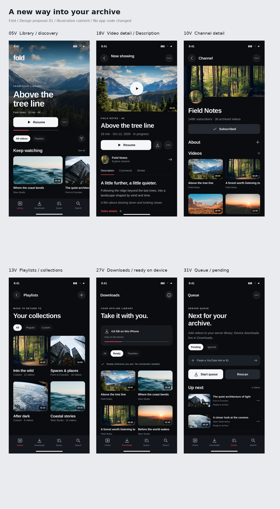

# Fold UI redesign — complete visual review

**Proposal 01 · October 20, 2026 · Design only. App code and main are unchanged.**

## Open the designs

The complete set contains **77 design images**, covering all 60 inventoried screens/state groups plus responsive, appearance, accessibility, system-boundary and phone-viewport companions. The four PDFs together contain every image.

- [Part 1 — pages 1–20](Fold-design-review-part-1.pdf)
- [Part 2 — pages 21–40](Fold-design-review-part-2.pdf)
- [Part 3 — pages 41–60](Fold-design-review-part-3.pdf)
- [Part 4 — pages 61–77](Fold-design-review-part-4.pdf)

On mobile, open a PDF and choose Download if GitHub cannot preview it.

## Overview

[Open overview at full resolution](overview.png)

## Inventory and design language

- [Complete source-derived screen inventory](screen-inventory.md)
- [Shared design system and reference sources](design-system.md)
- [PDF page index](page-index.json)

## Page-by-page index

- 1. 01 · Launch / restoring session — [Part 1, page1](Fold-design-review-part-1.pdf#page=1)
- 2. 02 · Connect to server — [Part 1, page2](Fold-design-review-part-1.pdf#page=2)
- 3. 03 · API token connection — [Part 1, page3](Fold-design-review-part-1.pdf#page=3)
- 4. 04 · Server sign-in sheet — [Part 1, page4](Fold-design-review-part-1.pdf#page=4)
- 5. 05 · Library / discovery — [Part 1, page5](Fold-design-review-part-1.pdf#page=5)
- 6. 05V · Library / discovery · phone viewport — [Part 1, page6](Fold-design-review-part-1.pdf#page=6)
- 7. 06 · Library filters and sorting — [Part 1, page7](Fold-design-review-part-1.pdf#page=7)
- 8. 07 · Library multi-selection — [Part 1, page8](Fold-design-review-part-1.pdf#page=8)
- 9. 08 · Search introduction / editing — [Part 1, page9](Fold-design-review-part-1.pdf#page=9)
- 10. 09 · Search results — [Part 1, page10](Fold-design-review-part-1.pdf#page=10)
- 11. 10 · Channel detail — [Part 1, page11](Fold-design-review-part-1.pdf#page=11)
- 12. 10V · Channel detail · phone viewport — [Part 1, page12](Fold-design-review-part-1.pdf#page=12)
- 13. 11 · Channel About expanded — [Part 1, page13](Fold-design-review-part-1.pdf#page=13)
- 14. 12 · Channel multi-selection — [Part 1, page14](Fold-design-review-part-1.pdf#page=14)
- 15. 13 · Playlists / collections — [Part 1, page15](Fold-design-review-part-1.pdf#page=15)
- 16. 13V · Playlists / collections · phone viewport — [Part 1, page16](Fold-design-review-part-1.pdf#page=16)
- 17. 14 · Playlist filter — [Part 1, page17](Fold-design-review-part-1.pdf#page=17)
- 18. 15 · Create playlist dialog — [Part 1, page18](Fold-design-review-part-1.pdf#page=18)
- 19. 16 · Regular playlist detail — [Part 1, page19](Fold-design-review-part-1.pdf#page=19)
- 20. 17 · Custom playlist detail — [Part 1, page20](Fold-design-review-part-1.pdf#page=20)
- 21. 18 · Video detail / Description — [Part 2, page1](Fold-design-review-part-2.pdf#page=1)
- 22. 18V · Video detail / Description · phone viewport — [Part 2, page2](Fold-design-review-part-2.pdf#page=2)
- 23. 19 · Video technical details expanded — [Part 2, page3](Fold-design-review-part-2.pdf#page=3)
- 24. 20 · Video comments and replies — [Part 2, page4](Fold-design-review-part-2.pdf#page=4)
- 25. 21 · Similar videos — [Part 2, page5](Fold-design-review-part-2.pdf#page=5)
- 26. 22 · Add to playlist sheet — [Part 2, page6](Fold-design-review-part-2.pdf#page=6)
- 27. 23 · Add to playlist empty — [Part 2, page7](Fold-design-review-part-2.pdf#page=7)
- 28. 24 · Native fullscreen playback — [Part 2, page8](Fold-design-review-part-2.pdf#page=8)
- 29. 25 · VLC fullscreen playback — [Part 2, page9](Fold-design-review-part-2.pdf#page=9)
- 30. 26 · Picture in Picture / pinned playback — [Part 2, page10](Fold-design-review-part-2.pdf#page=10)
- 31. 27 · Downloads / ready on device — [Part 2, page11](Fold-design-review-part-2.pdf#page=11)
- 32. 27V · Downloads / ready on device · phone viewport — [Part 2, page12](Fold-design-review-part-2.pdf#page=12)
- 33. 28 · Downloads / active transfers — [Part 2, page13](Fold-design-review-part-2.pdf#page=13)
- 34. 29 · Downloads information sheet — [Part 2, page14](Fold-design-review-part-2.pdf#page=14)
- 35. 30 · Offline video detail / playback — [Part 2, page15](Fold-design-review-part-2.pdf#page=15)
- 36. 31 · Queue / pending — [Part 2, page16](Fold-design-review-part-2.pdf#page=16)
- 37. 31V · Queue / pending · phone viewport — [Part 2, page17](Fold-design-review-part-2.pdf#page=17)
- 38. 32 · Queue / ignored — [Part 2, page18](Fold-design-review-part-2.pdf#page=18)
- 39. 33 · Queue / running task — [Part 2, page19](Fold-design-review-part-2.pdf#page=19)
- 40. 34 · Queue / add link editing — [Part 2, page20](Fold-design-review-part-2.pdf#page=20)
- 41. 35 · Queue item swipe actions — [Part 3, page1](Fold-design-review-part-3.pdf#page=1)
- 42. 36 · Settings / playback preferences — [Part 3, page2](Fold-design-review-part-3.pdf#page=2)
- 43. 37 · Seek interval picker — [Part 3, page3](Fold-design-review-part-3.pdf#page=3)
- 44. 38 · About — [Part 3, page4](Fold-design-review-part-3.pdf#page=4)
- 45. 39 · MobileVLCKit license — [Part 3, page5](Fold-design-review-part-3.pdf#page=5)
- 46. 40 · Fold license — [Part 3, page6](Fold-design-review-part-3.pdf#page=6)
- 47. 41 · Share extension / sending — [Part 3, page7](Fold-design-review-part-3.pdf#page=7)
- 48. 42 · Share extension / success — [Part 3, page8](Fold-design-review-part-3.pdf#page=8)
- 49. 43 · Share extension / errors — [Part 3, page9](Fold-design-review-part-3.pdf#page=9)
- 50. 44 · Delete server video confirmation — [Part 3, page10](Fold-design-review-part-3.pdf#page=10)
- 51. 45 · Delete selected videos confirmation — [Part 3, page11](Fold-design-review-part-3.pdf#page=11)
- 52. 46 · Delete queue item confirmation — [Part 3, page12](Fold-design-review-part-3.pdf#page=12)
- 53. 47 · Delete playlist detail confirmation — [Part 3, page13](Fold-design-review-part-3.pdf#page=13)
- 54. 48 · Delete playlist from list confirmation — [Part 3, page14](Fold-design-review-part-3.pdf#page=14)
- 55. 49 · Remove local copy confirmation — [Part 3, page15](Fold-design-review-part-3.pdf#page=15)
- 56. 50 · Sign out confirmation — [Part 3, page16](Fold-design-review-part-3.pdf#page=16)
- 57. 51 · Connection state board — [Part 3, page17](Fold-design-review-part-3.pdf#page=17)
- 58. 52 · Library state board — [Part 3, page18](Fold-design-review-part-3.pdf#page=18)
- 59. 53 · Search state board — [Part 3, page19](Fold-design-review-part-3.pdf#page=19)
- 60. 54 · Channel state board — [Part 3, page20](Fold-design-review-part-3.pdf#page=20)
- 61. 55 · Playlist states board — [Part 4, page1](Fold-design-review-part-4.pdf#page=1)
- 62. 56 · Video content states board — [Part 4, page2](Fold-design-review-part-4.pdf#page=2)
- 63. 57 · Downloads empty / filtering / storage — [Part 4, page3](Fold-design-review-part-4.pdf#page=3)
- 64. 58 · Transfer failure / recovery states — [Part 4, page4](Fold-design-review-part-4.pdf#page=4)
- 65. 59 · Queue loading / empty / failures — [Part 4, page5](Fold-design-review-part-4.pdf#page=5)
- 66. 60 · Player overlays / download CTA states — [Part 4, page6](Fold-design-review-part-4.pdf#page=6)
- 67. 61 · iPad Library — [Part 4, page7](Fold-design-review-part-4.pdf#page=7)
- 68. 62 · iPad Video detail — [Part 4, page8](Fold-design-review-part-4.pdf#page=8)
- 69. 63 · iPad Downloads — [Part 4, page9](Fold-design-review-part-4.pdf#page=9)
- 70. 64 · iPad Queue — [Part 4, page10](Fold-design-review-part-4.pdf#page=10)
- 71. 65 · iPad Playlists — [Part 4, page11](Fold-design-review-part-4.pdf#page=11)
- 72. 66 · iPad Settings — [Part 4, page12](Fold-design-review-part-4.pdf#page=12)
- 73. 67 · Light appearance · Downloads — [Part 4, page13](Fold-design-review-part-4.pdf#page=13)
- 74. 68 · Light appearance · Settings — [Part 4, page14](Fold-design-review-part-4.pdf#page=14)
- 75. 69 · Large text · Settings — [Part 4, page15](Fold-design-review-part-4.pdf#page=15)
- 76. 70 · System-owned surfaces — [Part 4, page16](Fold-design-review-part-4.pdf#page=16)
- 77. 71 · Search entry compatibility — [Part 4, page17](Fold-design-review-part-4.pdf#page=17)

## What you are reviewing

- A cinematic, artwork-led redesign using charcoal surfaces, white Play/Resume controls and restrained red accents.
- All main pages, expanded views, sheets, menus, confirmations, Share Extension states and loading/empty/error states from the inventory.
- Long-scroll boards expose below-the-fold content; V boards show a fixed phone viewport.
- The inventory is a static audit of commit 00d7455, not a claim of runtime testing.
- OS-owned controls and external sign-in page contents are explicitly distinguished from Fold-owned UI.
- Sample names, artwork, metadata and server addresses are illustrative, not private user data.
- The approved app icon is unchanged. The in-app wordmark is a proposed treatment.
- Library hero Resume is a proposed direct-play affordance; current behavior opens detail. Server acquisition Queue remains separate from on-device Downloads.

No implementation is included in this branch. Do not merge it as an app change. The full-resolution individual PNGs and original complete bundle are retained separately; this GitHub review publishes the overview and PDFs, not individual PNG links.